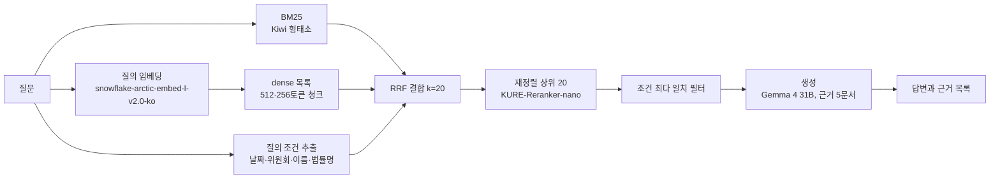
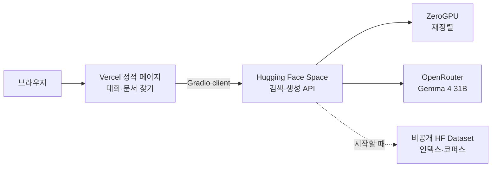

# 국회 회의록 RAG 프로젝트 회고 자료집 (2026-11-06)

블로그 포스트와 포트폴리오 발표 자료를 만들 때 고르는 재료다. 완성된 글이 아니다. 수치마다 출처(결정 `D-NN`, 실험 `EXP-NNN`, 문서 절)를 붙였다. 하네스와 운영 방식은 `harness-and-operations.md`에 따로 있다.

S41(공개 마감) 전에 썼다. 공개 뒤 배포 절의 지연·주소를 보강한다. AI Hub 데이터 원문(회의록 본문, 질의, 라벨)은 이 문서와 거기서 만드는 자료에 넣지 않는다.

## 독자별 쓰는 법

| 독자 | 매체 | 앞에 둘 것 |
| --- | --- | --- |
| 인사 담당자, 비실무 면접관 | 포트폴리오 발표 자료 | 무엇을 만들었나(질의응답 데모), 검색 정확도 0.86 → 0.96, 평가를 직접 설계했다는 점, 혼자 에이전트 팀을 운영한 방식 |
| 실무 면접관 | 포트폴리오, 질의응답 | multi-doc 평가 세트를 만든 이유와 절차, LLM judge 설계와 흔들림 처리, 판정 규칙(paired bootstrap, 최소 개선 폭), 기각한 실험 |
| 관련 분야 블로그 독자 | 블로그 | 데이터 한계에서 출발한 평가 설계, 실험별 수치와 실패 원인, judge 잡음을 다룬 방법 |

사용자가 내세우려는 것 둘: single-doc 데이터의 한계를 보완한 multi-doc 평가 세트, LLM-as-judge 평가 모듈(사용자 2026-11-06).

## 한 줄 요약

AI Hub 국회 회의록 38,516문서로 한국어 RAG 질의응답을 만들었다. 검색 Recall@5를 0.8584에서 0.9566(test 0.9577)으로 올렸고, 정답이 여러 문서에 나뉜 질의를 위한 평가 세트 600건과 RAGAS 정의를 빌린 LLM judge를 직접 만들어 생성 설정을 판정했다. Hugging Face Space(ZeroGPU)와 Vercel로 배포했다.

## 1. 문제와 데이터

| 항목 | 값 | 출처 |
| --- | --- | --- |
| 데이터 | AI Hub 「생성형AI 국회 회의록 기반 지식 검색 데이터」(2023 구축, 2024-12 갱신) | `docs/data.md` §1 |
| 코퍼스 | 고유 회의록 발언 구간(`context`) 38,516문서, 중앙값 1,947자(약 963토큰), 최대 82,243자 | data.md §8, §11 |
| 질의 | 요약 질의(`summary_q`) 39,633건, 질의당 정답 문서 1개 | data.md §16 |
| 회의 | 9,662회의, 회의의 75.4%가 질의응답 1건 | data.md §3 |
| 회의 연도 | 1996\~2023(화면의 연도 목록) | 배포 페이지 |
| 분할 | 회의 단위로 dev 3,016질의, test 3,003질의(seed 20260929, 회의구분 비율 유지) | SPEC "분할", D-02 |

데이터의 한계 셋이 평가 설계를 정했다.

1. **정답 문서가 하나다.** Recall@k가 적중률과 같아져, 근거가 여러 문서에 나뉜 질의(같은 법안의 여러 회의, 같은 의원의 여러 발언)를 볼 수 없다 → multi-doc 세트(D-12)
2. **질의가 생성물이다.** `summary_q`는 원 데이터 구축 때 만든 요약 질의라, 표본 100건 검수에서 PASS 40, PARTIAL 38, FAIL 22였다. 자동으로 거를 수 없어 전체를 썼다(D-03)
3. **답변의 정답이 없다.** 생성 답변을 채점할 기준 답이 없어 LLM judge를 만들었다(D-38). 원 데이터의 요약 답(`summary_a`)은 작은 모델이 만든 생성물이라 쓰지 않고, 답변 발언 원문을 핵심 답변 포함도의 참조로만 썼다(D-38)

## 2. 시스템 구조

| 구성 요소 | 최종 설정 | 근거 |
| --- | --- | --- |
| 청킹 | 고정 토큰 512/64(기준), dense에 256/32 추가 | EXP-011, D-29 |
| 임베딩 | `dragonkue/snowflake-arctic-embed-l-v2.0-ko`, 1,024차원 | EXP-009, D-28 |
| 벡터 검색 | numpy 전수 내적(벡터스토어 없음) | D-08, D-80 |
| BM25 | Kiwi 형태소, k1 1.5, b 0.75 | EXP-001 |
| 결합 | dense·BM25·조건 목록 RRF, k=20 | EXP-014, D-32 |
| 메타데이터 | 질의에서 9개 조건(날짜, 대수, 위원회, 이름, 법률명 등)을 뽑아 RRF 세 번째 목록과 최다 일치 필터로 사용 | EXP-003·004·008, D-23·24·27 |
| 재정렬 | `nlpai-lab/KURE-Reranker-nano`, RRF 상위 20개 | EXP-017, D-36 |
| 생성 | Gemma 4 31B(OpenRouter), 근거 5문서, 발언자 표시, 1위 근거 앞뒤 1청크 확장, 프롬프트 v19 | D-37, D-63, D-70, D-85 |
| judge | DeepSeek V4.1 Flash(opencode Go), 지시 j_v13 | D-38, D-73 |
| 배포 | Vercel 정적 페이지 → Hugging Face Space(ZeroGPU 무료, 비공개 Dataset에서 데이터 내려받음) | D-79, D-80, D-84 |
| 대화 | 앞 대화 최근 3턴을 받아 후속 질문을 검색 질의로 재작성 | S40, S51 |

## 3. 평가 설계

### 3.1 평가 층

| 층 | 질의 | 지표 | 쓰임 |
| --- | --- | --- | --- |
| dev-small | 약 1,000문서 코퍼스의 dev 질의 | 검색 지표 | 방향 확인, 판정에 쓰지 않음 |
| dev-full | dev 3,016질의, 전체 코퍼스 | 문서 단위 Recall@5(주), R@1, R@10, MRR@10 | 검색 EXP 판정 |
| multi-doc | 동결 600질의 | Recall@5·10, Complete@5·10, Hit@5·10 | 보조 관찰, 메타데이터 가설만 판정 |
| gen-small | 20질의 | 생성 지표 | 작동 확인 |
| gen-full | dev-full 앞 330질의 | 종합 지표(충실성·답변 관련성 평균)와 안전 조건 | 생성 EXP 판정 |
| test | 검색: test 전체, 생성: 앞 800질의 | 같은 지표 | 단계마다 1회 |

출처: SPEC "평가 층", D-50, D-53, D-87.

### 3.2 판정 규칙

- 기준과의 차이를 **회의 단위 paired bootstrap**(10,000회, 95% 구간)으로 낸다. 같은 회의의 질의는 서로 독립이 아니어서 회의를 재표본 단위로 썼다(SPEC "판정")
- 검색 채택: Recall@5 차이 구간 하한 > 0이고 점 추정 ≥ +1.0%p. 기각: 상한 < 0. 그 밖은 보류(SPEC "판정")
- 생성 채택: 종합 지표 차이 구간 하한 > 0, 점 추정 ≥ 0.02, 안전 조건 넷(충실성 하락, 관련성 하락, 과잉 거부, 발언자 잘못 귀속) 통과(D-53, D-68)
- 보류를 기준으로 올리는 예외 채택은 사람이 근거를 들어 정한다(D-28, D-33). 기각은 올리지 않는다
- 판정 기준과 EXP 문서는 실행 전에 커밋한다(하네스 ADR-0037)
- 가설 하나에서 변형이 3회 연속 비채택이면 멈춘다(D-18)

### 3.3 multi-doc 평가 세트 (내세울 것 1)

**왜:** 질의마다 정답 문서가 하나라 "근거가 여러 문서에 나뉜 질문"에서 검색기가 어떻게 동작할지 볼 수 없었다. 실제 사용에서는 "○○법 개정안을 다룬 회의들", "○○ 의원이 여러 회의에서 한 질의" 같은 질문이 흔하다(D-12).

**어떻게 만들었나**

| 단계 | 내용 | 출처 |
| --- | --- | --- |
| 1. 후보 묶음 | 메타데이터로 문서 묶음을 만든다: 같은 회의(`conf`), 같은 법안의 여러 회의(`law`), 같은 질의자·위원회의 여러 회의(`questioner`). 묶음당 최대 20문서. 검색기 점수로 고르지 않는다(누수 방지) | D-12, D-13 |
| 2. 질의 생성 | Claude Sonnet 에이전트가 묶음에서 서로 이어지는 문서를 골라 정답 2\~5문서짜리 질의와 답, 근거 인용을 쓴다 | D-14 |
| 3. 독립 검사 | 다른 Sonnet 에이전트가 생성 쪽 답·근거를 보지 않고 질의와 묶음 원문만으로 정답 문서를 다시 찾는다(훅으로 생성 출력 접근을 막음) | D-14 |
| 4. 코드 판정 | 인용이 원문에 있는지(표현이 다르면 문장 유사도로 후보를 고르고 한국어 판단 모델로 같은 의미인지 판정), 답할 수 있는지, 정답 2개 이상, 문서마다 그 문서에만 있는 요소가 있는지(필요성), 검사가 찾은 정답 = 생성 쪽 정답 | D-14 |
| 5. 사람 검수 | 638건 중 무작위 50건을 사용자가 검수(불량 6%, 모두 `law`). 같은 형식의 `law` 질의를 다시 판정하고 서브에이전트 재판정까지 거쳐 38건을 뺐다 | D-15 |
| 6. 동결 | 600건(`conf` 233, `law` 152, `questioner` 215)을 어떤 실험 점수도 보기 전에 SHA-256으로 동결 | D-12, D-15 |

파일럿 통과율은 지시 버전마다 5/30 → 8/30 → 11/40이었고, 검사 모델을 바꾼 뒤 20/40이었다(D-14). 검사 모델은 생성과 같은 계열이 되는 편향을 피하려 다른 회사 모델을 먼저 썼지만, 성능 차이를 보고 Sonnet으로 바꿨다(D-14).

**보여 준 것**

- 기준선(KURE-v1 dense): Recall@5 0.466, Complete@5 0.315. 유형별 Hit@5는 `conf` 0.983, `law` 0.513, `questioner` 0.298(D-16). 정답 문서 중 상위 10위 밖 비율이 `law` 62%, `questioner` 80%라, 실패는 순위가 아니라 문서를 찾지 못하는 데서 왔다(D-16)
- 원인: 질의는 날짜·위원회·의원 이름으로 회의를 지목하는데 인덱스는 발언 본문만 임베딩했다(D-16). 이 관찰이 메타데이터 조건 실험(EXP-003·004·008)으로 이어졌다
- single-doc에서는 차이가 0이던 메타데이터 조건이 multi-doc Recall@5를 +14.71%p, 최다 일치 필터가 +35.54%p 올렸다(EXP-003, EXP-004)
- 반대로 single-doc에서 채택한 BM25 결합은 multi-doc을 −3.21%p 내렸다(EXP-001). 한 세트만 봤으면 몰랐을 변화다
- 최종: Recall@5 0.4657 → 0.9514, Complete@5 0.3150 → 0.9083(`docs/search-stage-summary.md`)

**한계:** 질의를 LLM이 만들었고 사람 검수는 표본과 `law` 일부만 했다. test 세트를 두지 않아 multi-doc으로 채택한 설정은 test로 다시 확인하지 못했다(SPEC "메타데이터 가설의 판정"). 판정에 쓰지 않는 보조 관찰로 둔 것은 지표를 여럿 두고 유리한 쪽을 고르는 것처럼 보이지 않게 하려는 것이다(D-12).

### 3.4 LLM-as-judge 생성 평가 모듈 (내세울 것 2)

**왜 직접 만들었나:** 답변의 정답이 없고, 한국어 회의록에 맞춘 지시를 config로 버전 관리하려고 RAGAS 라이브러리 대신 지표 정의만 빌려 직접 구현했다(D-38).

| 지표 | 정의 | 쓰임 | 출처 |
| --- | --- | --- | --- |
| 충실성 | 답변 진술 중 근거로 뒷받침된 비율(RAGAS faithfulness를 고침) | 종합 지표 | D-38 |
| 답변 관련성 | 질의에 답함 1, 일부 0.5, 답하지 않음 0 | 종합 지표 | D-40 |
| 핵심 답변 포함도 | 답변 발언 원문에서 뽑은 핵심 진술 중 답변에 담긴 비율(ragas answer correctness를 고침) | 보조 | D-38, D-53 |
| 거부 정확도 | 근거에 답이 없을 때 거부했는지(RGB negative rejection 계열) | 참고 | D-38, D-52 |
| 과잉 거부율 | 답할 수 있는데 거부한 비율 | 안전 조건 | D-52 |
| 발언자 불일치 | 발언을 다른 사람 말로 옮긴 비율 | 안전 조건 | D-68 |

**흔들림을 다룬 방법**

- 같은 설정을 다시 생성·채점해 차이의 95% 구간 반폭을 쟀다: 충실성 0.031, 관련성 0.021, 종합 0.019(330질의 어림, D-53)
- 이 폭으로 판정 세트 크기(330)와 최소 개선 폭(0.02)을 정했다(D-44, D-50, D-53). 기준별 하락 허용폭은 반폭의 1.65배라 같은 설정끼리 비교하면 약 90%가 통과한다(D-53)
- 종합 지표의 가중치는 근거 있는 가중이 사람 선호 데이터에서만 나와, 사람 판단 데이터가 없어 동일 가중으로 했다(D-53, `docs/research/composite-weighting.md`)
- 오라클 진단: 정답 문서를 근거에 넣어도 평균이 거의 같아, 점수 한계는 검색이 아니라 생성(또는 평가)과 RAG에 맞지 않게 만들어진 질의에 있었다(D-53, S26)
- 오차 분석(세트 밖 100질의): 손실 몫은 답변 오류 47.6%, judge 적용 잡음 31.5%, 규칙과 지시 충돌 10.5%(S43, 서브에이전트 판독). judge를 고치면 지금까지의 개선폭을 같은 지표로 설명할 수 없어 고치지 않았다(D-82)

**만들면서 드러난 것:** 시간은 지표 수식보다 회의록 고유의 판정 규칙(질의자의 주장을 답으로 볼지, 부분 거부를 어떻게 셀지, 발언자 귀속)에 들었다. judge 지시는 j_v2에서 j_v13까지 바뀌었고 그동안 기준선을 여러 번 다시 채점했다(하네스 회고 참고).

## 4. 검색 실험 (17개)

dev-full Recall@5, 기준 대비 차이와 95% 구간. multi-doc 값은 보조(메타데이터 가설은 판정).

| EXP | 바꾼 것 | Recall@5 | 차이 [구간] | 판정 |
| --- | --- | ---: | --- | --- |
| base | KURE-v1 dense, 512/64 | 0.8584 | | 기준 |
| 001 | BM25(Kiwi) RRF 결합 | 0.9168 | +5.84 [+4.93, +6.76] | 채택 |
| 002 | BM25 문서에 메타데이터 접두 | 0.8906 | −2.62 [−4.02, −1.39] | 기각 |
| 003 | 질의 조건 목록을 RRF 세 번째 목록으로 | | single +0.00, multi-doc +14.71 | 채택(multi-doc) |
| 004 | 조건 최다 일치 필터 | | multi-doc +35.54 | 채택(multi-doc) |
| 005 | LLM 판단 모델 Jev 재정렬 | 0.8856 | −3.08 [−4.16, −2.04] | 기각 |
| 006 | KURE-Reranker-nano 재정렬 | 0.9473 | +3.08 [+2.29, +3.86] | 채택, 운영 보류(CPU 질의당 37초) |
| 007 | dense 2위 청크 점수 가산 | 0.8929 | −2.35 [−3.01, −1.75] | 기각 |
| 008 | 법률명 조건 추가 | | multi-doc +1.65 | 채택(multi-doc) |
| 009 | 임베딩 snowflake-ko | 0.9214 | +0.50 [−0.13, +1.14] | 보류, 임베딩만 예외 채택(dense 단독 +2.25) |
| 010 | dense 가중치 2 | 0.9168 | +0.03 [−0.62, +0.69] | 보류 |
| 011 | 256 청크 추가 | 0.9337 | +1.23 [+0.74, +1.73] | 채택 |
| 012 | 문장 경계 청킹 | 0.9350 | +0.13 [−0.23, +0.51] | 보류 |
| 013 | 저신뢰 질의 LLM 재작성 | 0.9287 | −0.50 [−0.89, −0.10] | 기각 |
| 014 | RRF k 60 → 20 | 0.9413 | +0.76 [+0.38, +1.16] | 보류, 예외 채택 |
| 015 | 점수 기반 결합 | 0.9456 | +0.43 [+0.07, +0.80] | 보류 |
| 016 | 점수 결합에서 조건 목록 제거 | 0.9456 | +0.43 | 보류 |
| 017 | 014 + 재정렬(GPU) | **0.9566** | +1.53 [+0.91, +2.15] | 채택, 최종 기준 |

출처: `docs/EXPERIMENTS.md`, `docs/search-stage-summary.md`, 각 `docs/experiments/EXP-NNN.md`, D-17\~D-36. 검색 단계 test 1회: Recall@5 **0.9577**(D-39).

### 기각·보류에서 배운 것

| EXP | 시도 | 왜 안 됐나 | 출처 |
| --- | --- | --- | --- |
| 002 | BM25 문서에 메타데이터 붙이기 | 긴 안건 접두가 청크를 약 3배로 늘려 BM25 길이 정규화가 본문 점수를 깎았다 | EXP-002 |
| 005 | LLM 판단 모델 재정렬 | Recall@1 −11.77%p, 1위 정답을 밀어냈다 | EXP-005 |
| 007 | 여러 청크 점수 가산 | 5위 밖으로 밀린 78건 중 70건이 청크 1개짜리 정답 문서였다 | EXP-007 |
| 013 | 질의 재작성 | 재작성 대상 362건 중 64%가 이미 상위 5위에 정답이 있었고, 놓친 131건 중 10건만 살렸다 | EXP-013 |
| 009 | 임베딩 교체 | dense 단독은 +2.25%p였지만 hybrid에서는 BM25가 이미 메워 +0.50%p에 그쳤다. 이후 실험이 올라설 부품이라 예외 채택 | EXP-009, D-28 |
| 015·016 | 점수 기반 결합 | single-doc은 조금 올랐지만 multi-doc `law`가 내려갔다 | EXP-015, EXP-016 |

## 5. 생성 실험

gen-full 330질의 종합 지표. judge 지시가 실험마다 달라(j_v8 → j_v13) 실험 사이의 절대값은 비교하지 않고, 각 실험은 같은 judge로 다시 채점한 기준과 비교했다.

| EXP | 바꾼 것 | 종합 지표 (후보 대 기준) | 판정 |
| --- | --- | --- | --- |
| 018 | 지정 거부 문구, 거부는 별도 문장(v3) | 0.849 대 0.847, +0.001 | 보류 → 예외 채택(지정 문구 없는 거부 23 → 4) |
| 019 | 발언자 머리 줄(v4) | 0.870 대 0.855, +0.014 | 보류, 기준 전환은 제품 요구로 |
| 020 | 답 먼저·발언자 표기(v6) | 0.894 대 0.882, +0.011 | 보류(관련성 하락 안전 조건, 잘못 귀속 증가) |
| 021 | 발언 구간 표지, 1위 근거 확장(v8) | 0.937 대 0.878, **+0.059** [+0.038, +0.081] | 채택(충실성 +0.109) |
| 022 | 회의별 나눠 쓰기(v9) | 0.930 대 0.934, −0.004 | 보류(인용 없는 답변 0 → 11) |
| 023 | v9 + 근거 번호 보강(v10) | 0.935 대 0.934, +0.000 | 보류 → 예외 채택(인용 누락 11 → 1) |
| 026 | 문단 통일, 문장마다 근거 번호(v16) | 0.935 대 0.933 | 화면 형식 변경, 판정 실험 아님 |
| 029 | 근거에 없는 답 밝히기(v19) | 0.935 대 0.934 | 화면 형식 변경, 판정 실험 아님 |

출처: `docs/EXPERIMENTS.md` 생성 단계, EXP-018\~023, D-61\~D-85.

**생성 단계 test 1회**(800질의, gen-full과 짝 비교가 아님, D-90):

| 지표 | gen-full | test |
| --- | ---: | ---: |
| 종합 지표 | 0.935 | 0.935 |
| 충실성 | 0.985 | 0.984 |
| 답변 관련성 | 0.884 | 0.886 |
| 핵심 답변 포함도 | 0.735 | 0.739 |
| 과잉 거부율 | 0.003 | 0.018 |
| 발언자 불일치 비율 | 0.006 | 0.011 |

dev를 반복해 쓴 낙관이 test에서 거의 드러나지 않았다. 과잉 거부율과 발언자 불일치는 test에서 조금 높다.

## 6. 지연과 비용

| 항목 | 값 | 출처 |
| --- | --- | --- |
| 재정렬(T4 GPU, 20쌍) | 질의당 평균 0.44초, p95 0.47초 | EXP-017 |
| 재정렬(CPU 2스레드) | 질의당 평균 37.1초 → GPU 없이는 운영 불가, 운영 보류 뒤 ZeroGPU로 해결 | EXP-006, D-26, D-84 |
| 검색 CPU 단계 | 질의 임베딩 0.30초, 1차 검색 0.10초 | EXP-017 |
| 생성 첫 토큰 | 중앙값 0.68\~0.89초(실험별) | EXP-019\~023 |
| 지연 목표 | 첫 토큰 3초 이내(중앙값) | D-30 |
| 생성 비용 | 1,000질의당 약 $0.35\~0.37(Gemma 4 31B) | EXP-021\~023 |
| 프로젝트 API 비용 | OpenRouter 약 $5, judge는 opencode Go 구독 월 사용량의 37%, Colab 20 CU 미만 | 사용자 |
| 호스팅 | Hugging Face Space ZeroGPU 무료, Vercel | D-80, D-84 |

공개 뒤 첫 토큰 지연을 다시 재서 보강한다(PLAN S41).

## 7. 배포

- 화면: 대화(스트리밍 답변과 근거 목록), 연도·회의·문서로 회의록 찾기, 답변 근거를 누르면 해당 발언 구간이 열리는 문서 보기(S35, S36, S39b, S45)
- 대화 이어 가기: 앞 대화 최근 3턴을 받아 후속 질문을 재작성해 검색한다(S40, S51)
- 데이터 취급: 데이터는 비공개 Dataset에 두고 Space 시작 때 내려받는다. 평가 질의와 요약 라벨은 화면에 보이지 않는다(D-74, D-79)
- 공개 전 남은 일: 디자인 점검 수정(S52, `docs/reviews/2026-11-design-review.md`), 추천 질의와 첫 구동 안내, Space 공개(S41)

## 8. 한계

| 한계 | 출처 |
| --- | --- |
| 평가 질의가 생성물이고 품질이 고르지 않다(FAIL 22%) | D-03 |
| multi-doc 세트는 LLM이 만들었고 test가 없어, multi-doc으로 채택한 메타데이터 설정은 test로 다시 확인하지 못했다 | D-12, D-15 |
| judge는 사람 판정과 맞춰 보지 않았다. 손실 몫의 약 3할이 judge 잡음으로 판독됐다 | D-51, D-82 |
| 생성 판정 세트 330질의는 흔들림 반폭 0.019 수준의 차이까지만 가른다 | D-50, D-53 |
| 생성 실험 사이의 절대 점수는 judge 버전이 달라 비교할 수 없다 | EXPERIMENTS.md 생성 단계 |
| 검색 결과 순위는 단일 정답 기준이라 여러 문서를 모아 답해야 하는 질문의 답변 품질은 따로 재지 않았다(생성 multi-doc 관찰을 매번 하지 않음) | D-53 결정 7 |

## 9. 배운 것 (RAG 중심)

- **평가가 주어지지 않은 문제는 평가 설계가 본론이다.** 이번 프로젝트의 가장 큰 시간과 가장 큰 성과(multi-doc 세트, judge)가 모두 평가에서 나왔다
- **한 가지 평가만 보면 놓친다.** BM25 결합은 single-doc을 올리고 multi-doc을 내렸고, 메타데이터 조건은 그 반대였다(EXP-001, 003, 004)
- **하이브리드가 이미 메운 것은 부품 교체로 다시 오르지 않는다.** 임베딩 교체는 dense 단독 +2.25%p였지만 hybrid에서 +0.50%p였다(EXP-009)
- **LLM을 넣는다고 오르지 않는다.** LLM 판단 모델 재정렬(EXP-005)과 LLM 질의 재작성(EXP-013)은 모두 기각됐고, 작은 cross-encoder 재정렬(EXP-006, 017)이 이겼다
- **메타데이터는 회의록 검색의 핵심 신호다.** 질의가 날짜·위원회·의원 이름으로 회의를 지목하는데 본문 임베딩에는 이 정보가 없다(D-16)
- **LLM judge는 흔들림을 재고 그 폭으로 판정선을 정한다.** 개선폭이 흔들림보다 작으면 판정이 뒤집힌다(D-53)
- **평가기는 언제 그만 고칠지 먼저 정한다.** 고칠 때마다 기준선을 다시 채점해야 한다(하네스 회고)

## 10. 블로그·발표 소재 후보

| 소재 | 쓸 재료 |
| --- | --- |
| 정답이 하나인 데이터로 여러 문서 검색을 평가하기 | 3.3 절, EXP-001·003·004 대비 |
| 정답 없는 답변을 채점하기: LLM judge 설계와 흔들림 | 3.4 절, D-53 수치 |
| 실패한 실험들: LLM 재정렬, 질의 재작성, 문장 청킹 | 4 절 기각·보류 표 |
| 회의록 RAG에서 메타데이터의 힘 | D-16 관찰, EXP-003·004·008 |
| 무료 GPU로 RAG 데모 배포하기 | 7 절, D-80, D-84 |
| 혼자서 에이전트 팀으로 ML 프로젝트 운영하기 | `harness-and-operations.md` |

## 확인하지 못한 것

- 검색 test의 Recall@1·@10·MRR은 기록에 없다(Recall@5만 기록)
- 생성 실험 수치는 opencode worker가 EXP 문서와 EXPERIMENTS에서 옮긴 것이다. 메인은 검색 기준·최종·test, multi-doc 기준·최종, 생성 test 표를 원문과 대조했다
- 배포 지연과 공개 주소는 S41 뒤 보강한다
